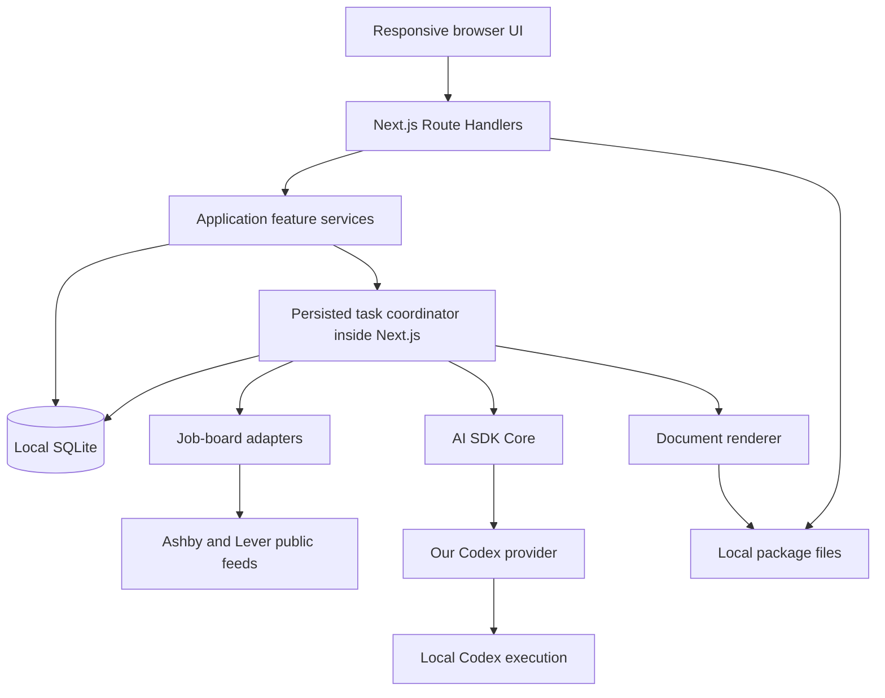

# Local-first architecture

Status: agreed target as of 2026-10-17. The workspace foundation is implemented in `apps/web` and `packages/db`; the product workflows below remain planned. See the [technology stack](tech-stack.md) for libraries and the [roadmap](roadmap.md) for delivery themes.

## Product boundary

Build a personal job-search workspace that someone can clone from GitHub and run locally. It tracks company boards, indexes their openings, provides an unread inbox and useful discovery filters, prepares application material from the user's experience, and records application progress manually.

The responsive browser interface connects to a persistent local Next.js server. Boards, indexed data, statuses, profile context, notes, task records, and generated packages live on the user's machine. Public board requests and configured AI inference can use the network. Core indexing and tracking do not require AI.

The initial system has one local workspace and no external database, hosted account service, synchronization, or billing. Paid additions may be explored later. Responsive layouts do not imply remote access or cross-device data synchronization.

## Workspace responsibilities

```text
apps/
  web/                  Next.js UI, routes, feature services, task coordination
packages/
  db/                   Drizzle schema, migrations, database access
  job-boards/           Shared feed contract, Ashby and Lever adapters
  ai-codex/             Our AI SDK provider and local Codex execution boundary
  documents/            Structured content to PDF, Markdown/text, and ZIP
openspec/               Stack, architecture, roadmap, specs, and changes
```

Use pnpm workspaces. Introduce each package when its feature needs it; the tree is a responsibility map, not a requirement to scaffold empty packages immediately.

`apps/web` owns product workflows, prompts, taxonomy policy, profile selection, task scheduling, and application lifecycle rules. The Codex provider knows how to execute a generation request; it does not know about job boards, application statuses, or database tables. The documents package renders validated content; the application owns file persistence and version selection.

The app composes packages. Packages must not import the app. Rendering, job-board, and AI packages must not access SQLite directly or create an HTTP service. Keep shared route schemas near their feature in the app until another workspace actually needs them; avoid a catch-all shared package. Mark database, filesystem, and execution entry points server-only.

## Runtime and data flow



Use the Next.js Node runtime for database and task routes. This design assumes a persistent local server, rather than Edge execution or a short-lived serverless deployment. There is no separate worker service.

TanStack Query reads the local API and invalidates affected results after mutations. Display indexed data immediately and show refresh or generation progress separately. Poll task status while relevant tasks are active; a streaming infrastructure is not required for basic progress.

nuqs owns shareable discovery state such as query text, filters, sorting, and pagination. React state owns transient panels and selections. Profile content and application answers must not be stored in URL parameters. Ordinary server reads and route prefetches must not trigger refreshes or mark jobs read.

## Local persistence

Use a configurable data root with a gitignored local default. Keep the database and package files separate from source and build output. Resolve paths with platform-aware APIs rather than shell-specific commands.

```text
<data-root>/
  job-board.sqlite
  packages/
    <internal-posting-id>/
      <package-id>/
        resume.pdf
        resume.md
        answers.json
        answers.md
        manifest.json
        application.zip
```

Cover-letter files appear only when requested. A manifest records the actual files, version, generation inputs and provenance, and checksums where useful. Downloads serve stored bytes or a retained ZIP; they do not call the agent or rerender against a newer template.

The logical data model includes:

| Area | Stored information and invariants |
| --- | --- |
| Boards | Provider, provider-specific board key, canonical source URL, display company, active/archive state, and last successful refresh. |
| Postings | Internal UUID, board-scoped external reference, content, URLs, raw provider data, first/last seen timestamps, availability, content hash, and read state. |
| Locations | Multiple normalized countries/regions per posting, separate workplace type, original text, and retained eligibility restrictions. |
| Taxonomy | Role and department tags, aliases, posting associations, and classification provenance. |
| Tasks | Kind, target, input/version identity, state, ownership, progress, timestamps, and safe failure details. |
| Profile blocks | Reusable contact information, experience, skills, projects, education, notes, and custom blocks. |
| Applications | One record per internal posting, manual status, applied date, selected submitted package or an explicit indication that no generated package was used. |
| Application notes | Dated notes attached to the application's history. |
| Packages | Draft or retained versions, exact generation context, structured answers, file manifest, and submission association. |

These are domain boundaries, not a mandatory one-table-per-row prescription. Define concrete tables and indexes in the relevant feature change. Use foreign keys and uniqueness constraints for invariants such as one application per internal posting and at most one current live mapping for a board's external reference. Keep timestamps in UTC and preserve the semantics of user-entered calendar dates.

There is no backup feature in the initial implementation scope; backup and restore remain a later exploration. Storing data in SQLite does not imply a separate backup or recovery service.

## Company boards and provider adapters

Support Ashby and Lever first, including URLs such as `https://jobs.ashbyhq.com/ramp` and `https://jobs.lever.co/moonpay`. Identify supported provider URLs, normalize their board keys, and prevent duplicate tracked sources. Unsupported URLs receive a clear result; the initial system is not a generic website crawler.

Each provider adapter must:

- Recognize and canonicalize its board URL.
- Fetch every page or segment required for a complete board snapshot.
- Validate the feed and normalize postings into a shared typed shape.
- Retain original locations, restrictions, salary data, descriptions, and relevant raw fields.
- Return an explicit complete success or a failure with diagnostics.

The shared posting shape includes the external reference, title, description HTML where supplied, plain-text description, job and application URLs, locations, workplace information, salary data when present, source timestamps when available, and raw provider data. Company context comes from the tracked board; adapters retain more precise source fields if provided.

Adapters perform source-specific parsing. Shared services perform persistence, identity reconciliation, deterministic normalization, unread management, and AI scheduling. Adding another provider means implementing the same adapter contract and its contract tests.

Archive a board to stop refreshes and remove its postings from active discovery and unread counts. Preserve indexed data, notes, application history, and package downloads. Restoring the board makes it eligible for refresh again; archival itself is not evidence that the employer removed a posting.

## Refresh and task lifecycle

On the initial browser visit to the app, render local results and request refreshes for active tracked boards. A browser reload or later reopening may request another refresh. Navigation, route prefetching, and focus changes do not independently request reindexing. Each board also has a manual refresh action. Timer refreshes are a later addition.

A mutation persists or coalesces a task and returns promptly. The server can use Next.js `after(async () => await drain())` to run a bounded coordinator after responding. The coordinator must await its asynchronous work; an untracked fire-and-forget promise is not the task system.

Task states include queued, running, succeeded, failed, interrupted, and cancelled. Use atomic database claims and target-level deduplication so simultaneous tabs, repeated actions, or development reloads do not run the same board refresh concurrently. Serialize application generation for the same internal posting so competing tasks cannot overwrite its current draft or submission association. A process-level guard can reduce duplicate coordinator starts in development, but database ownership is authoritative.

Bound provider requests and AI execution independently. Keep fetches, agent execution, and document rendering outside transactions. The synchronous SQLite driver is suitable for short local operations; do not perform large CPU-heavy work in request handlers.

Persist progress and outcomes so browser navigation does not lose the task. On server restart, queued work can resume. Recover abandoned running tasks as interrupted once ownership is known to be stale; do not blindly repeat an AI operation that might already have incurred cost. Expose explicit retry. Cancellation or failure must leave previously committed data and the last valid package available.

Provider failures are independent. Successful boards update even if another board fails. Show per-board activity, last successful refresh, and error state while retaining the previous usable index.

Reconcile a board only after its complete snapshot has been fetched and validated. In one short transaction, update continuously visible postings, create new postings, mark genuinely missing live postings unavailable, and advance successful-refresh metadata. A timeout, malformed item, failed pagination, or ambiguous duplicate external reference must not turn into a successful empty or partial snapshot. A valid complete empty feed can legitimately close all live postings.

## Posting identity and lifecycle

Provider IDs are external correlation keys, never internal primary keys. Match a continuously visible live posting using the board and external reference. Ordinary changes to that live record update its content without resetting read state or application history.

When a complete successful snapshot no longer contains a live posting, mark it unavailable and hide it from the active view. Preserve its data and relationships. If that external reference later appears after the observed absence, fully index it as a new internal posting with its own UUID and unread state. Do not attach the old application or package history to it automatically.

| Observation | Result |
| --- | --- |
| Reference remains continuously present | Update the existing live internal posting. |
| Reference is absent in a complete successful snapshot | Preserve the posting and mark it unavailable. |
| Previously unavailable reference reappears | Create a separate internal posting and fully index it. |
| Employer replaces a job under a continuously present reference | Allow an explicit treat-as-new correction when detected by the user. |

A snapshot feed cannot prove that a delete and recreation happened between polls if the reference remains present. Content changes alone do not reliably establish replacement. This is a known source limitation, not a reason to conflate provider and internal identity.

## Unread inbox

Unread state belongs to each internal posting and is persisted locally. Initial imports and new postings start unread. Refreshes add unread items without clearing earlier unread items.

Entering the actual full-details view marks the posting read. A list card, route prefetch, or background refresh does not. Support explicit mark read, mark unread, and bulk operations. Marking unread while viewing a posting must remain effective until a later visit or explicit read action; a rerender must not immediately undo it. Description edits do not automatically create another unread notification.

For example, importing ten postings and reading four leaves six unread. If the next refresh adds fifteen postings, twenty-one remain unread. Unavailable postings and archived boards do not contribute to active unread counts, while their history remains stored.

The initial notification system is this persistent in-app inbox and its counts. It does not require browser push, operating-system notifications, email delivery, or refreshing while the local server is stopped.

## Search, filters, and normalization

Index all postings from supported boards. Apply user preferences to the local index rather than excluding departments or roles during ingestion.

Support title/description text search and filters for company, geography, workplace type, role tags, and department tags. Start search with parameterized Drizzle contains predicates over titles and plain-text descriptions. Treat typed text safely as a search value rather than executable SQL. Add FTS5 only if measured volume or relevance needs justify the extra index management.

Normalize geography deterministically into countries and broad regions, allowing multiple locations per posting. Keep the original text and eligibility restrictions available in the interface. Workplace type—remote, hybrid, on-site, or unknown—is a separate dimension.

EU-labelled and Europe-labelled roles can share the Europe discovery group without implying identical eligibility. An exact Spain filter matches postings explicitly normalized to Spain; it must not broaden to other EU countries or assume an unspecified Europe-wide posting is eligible in Spain. Avoid inferring a country or workplace type when the source does not establish one.

Retain salary amounts, currency, period, ranges, and original text when supplied. Salary filters, currency conversion, and comparisons between compensation periods are deferred.

Use overlapping role and department tags. Seed roles with Software Engineer, Design Engineer, Frontend Engineer, Backend Engineer, and Fullstack Engineer. The classifier can propose a new role, such as Data Scientist, if no existing role applies; normalize aliases and duplicates before storing it.

Departments describe work disciplines, not company industry. Initial examples are Software Engineering, AI/ML, Data, Product, Design, and Finance. Keep Unknown for uncertain or uncategorized postings. A posting may have multiple applicable roles or departments.

## Optional local Codex integration

The application calls AI SDK Core using our own provider from `packages/ai-codex`. Keep the package in this monorepo and independent of product workflows. A separate published package can be considered if another project needs it.

Evaluate the official Codex SDK as the execution layer. Before accepting a pinned version, verify installed-runtime selection, saved authentication, schema output, cancellation, and configuration/context controls. If it cannot meet those requirements, put a small direct `codex exec` runner behind the same provider. Do not introduce the rejected community provider or a hosted harness dependency as a fallback.

The provider maps supported AI SDK text requests, output schemas, model settings, results, usage where available, and errors. It supports fresh independent executions, timeout/cancellation cleanup, and explicit unsupported-capability errors. Initial streaming may return completed output in one chunk; do not manufacture token events or usage values that Codex did not report.

Codex controls authentication. Use a dedicated task working directory and intentionally restricted tools and configuration inheritance. Verify that unrelated repository instructions, global skills, MCP configuration, and private files do not enter a generation merely because the user has them configured elsewhere. A read-only filesystem setting alone does not prove tools or network access are disabled.

Categorization receives only the relevant posting fields, the taxonomy snapshot, instructions, and output schema. It does not need the user's profile. Run bounded batches after ingestion has committed. Cache classification by relevant content, model, taxonomy, and prompt/schema versions. A cache change alone does not schedule regeneration of every existing record.

Automatic categorization is opt-in after configuration. Queue new or meaningfully changed postings when enabled and allow explicit retry. Unavailable agents, invalid results, or failed batches must not block ingestion. Unclassified or uncertain jobs remain discoverable as Unknown. Validate generated role proposals before extending the catalog.

Application generation receives one internal posting's description, selected profile blocks, relevant user instructions, and manually entered application questions and limits. Treat employer descriptions and other imported content as untrusted task data. The model supplies content, while application code controls file paths, persistence, rendering, and history.

Allow an explicitly selected inexpensive model if available to the user's Codex installation and account. A local agent runner does not guarantee offline inference or make every advertised model available. Fail clearly instead of silently changing model cost or authentication mode.

## Profile workspace and application packages

Provide reusable information blocks for contact details, experience, skills, projects, education, notes, and custom context. Use structured fields where useful and text/Markdown for descriptive content. Per-posting notes, instructions, and manually entered employer questions supplement the selected profile context.

Tailor each resume to its own posting using the user's actual experience. Generated claims must be grounded in the supplied context; ask for or flag missing information rather than inventing qualifications or answers.

A package includes a PDF resume, editable Markdown/text, copyable answers, and other requested material such as a cover letter. Provide individual downloads and a ZIP. Each generation records the exact posting/profile/question context and model/prompt information used to produce its contents.

Before the application has ever been marked applied, an explicit regeneration replaces that posting's unsubmitted draft. Build and validate the replacement before switching the current draft, so a failed generation leaves the previous valid draft intact. At commit, recheck submission state so a concurrent applied confirmation cannot cause a submitted package to be overwritten. Regeneration affects no other posting.

When the user marks the application applied, they select the package actually used or record that they applied without a generated package. Freeze the selected package's files, answers, and already captured generation context, and associate the submission date. Do not replace its context with a newer profile or job description at submission time.

Once the application has been marked applied, retain later generated versions alongside the submitted version. Moving to another application status does not erase that submitted history. Profile or posting edits never regenerate packages automatically, regardless of application status.

Users can redownload current drafts and retained versions, including after a posting becomes unavailable or its board is archived. Downloads reproduce the saved package without another AI call. Do not delete a submitted package as a side effect of regenerating a draft or changing a board's visibility.

## Manual application progress

Keep one application record per internal posting. Do not model repeated attempts initially. Supported manual statuses are Preparing, Applied, Interviewing, Offer, Accepted, Rejected, and Withdrawn, with dated notes and an explicit applied date when applicable.

Generating or downloading material, opening the employer's page, and generating another version do not mark an application applied. Status changes are user actions. The application package is useful independently of any future form integration.

Opening an employer application URL is supported as a navigation action. Automatically filling its fields, attaching files, or answering its questions is a separate later exploration. The user remains responsible for the final submission.

## Local boundaries and failure handling

- Bind the initial server to the local machine. Validate mutation inputs and request origin/host boundaries before exposing profile or filesystem actions.
- Resolve supported board endpoints and expected redirects deliberately; adding a board must not permit arbitrary local-network fetching.
- Keep original description HTML as source data when needed, and render plain text or appropriately sanitized content. Never render untrusted feed HTML directly.
- Keep generated files inside the configured data root and resolve downloads by stored identifiers, rather than accepting arbitrary filesystem paths from the browser.
- Stage files before committing a package reference; clean up abandoned temporary output without removing the last valid or submitted version.
- Keep model output out of database commands and executable code. Persist validated content through normal application services.
- Preserve the previous index on provider failure and preserve the previous package on generation failure. Surface actionable errors without logging profile contents or authentication secrets by default.

## Implementation checks

Focused feature changes should verify reconciliation on partial and empty feeds, identity reuse, persisted unread state, exact-country matching, taxonomy validation, task deduplication and interruption, schema/cancellation behavior, package replacement and retention, and redownload after archival. Use temporary databases and provider/execution fixtures for routine checks. The [stack document](tech-stack.md) lists cross-platform and dependency checks still to perform.

Interview preparation, periodic refresh, form prefilling, batch generation, batch application assistance, backups, additional providers, and optional paid features remain roadmap work rather than hidden requirements of the initial runtime.
