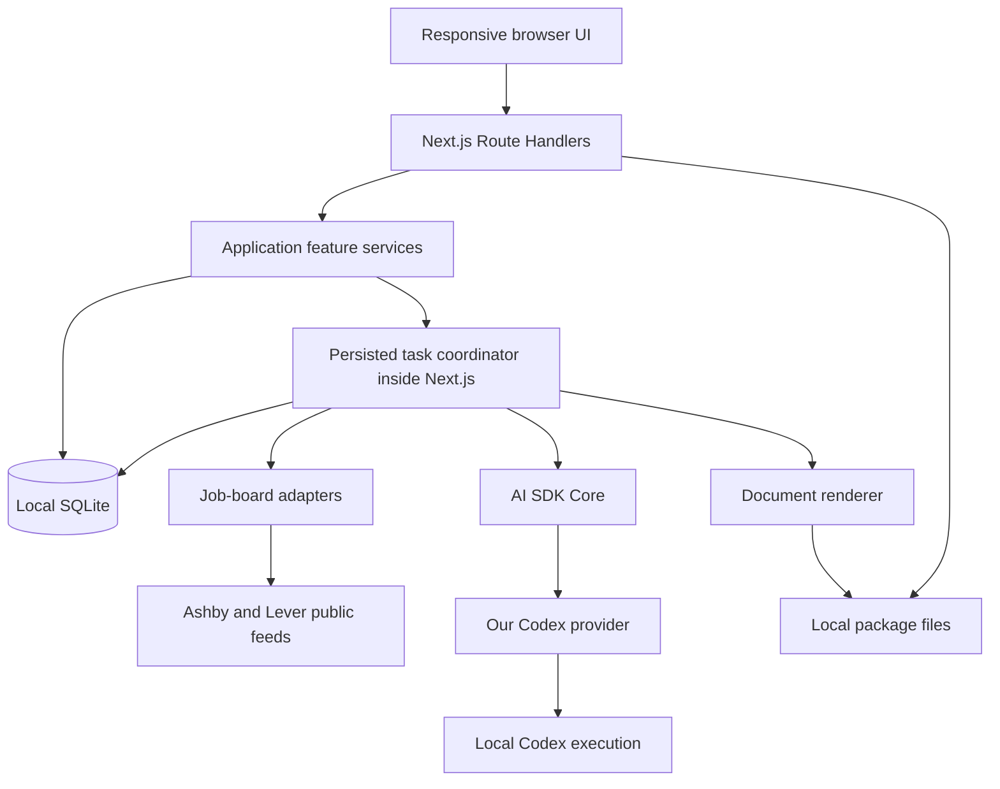

# Local-first architecture

Status: agreed target, updated 2026-11-18. Workspace foundations, company board management, Ashby/Lever indexing, refresh coordination, and local Jobs browsing with an inset workspace shell, contextual reader, persistent unread Inbox, and local text/board/workplace/country/region/department filtering are implemented in `apps/web`, `packages/db`, and `packages/job-boards`. AI taxonomy and subsequent product workflows below remain planned. See the [technology stack](tech-stack.md) for libraries and the [roadmap](roadmap.md) for delivery themes.

## Product boundary

Build a personal job-search workspace that someone can clone from GitHub and run locally. It tracks company boards, indexes their openings, provides an unread inbox and useful discovery filters, prepares application material from the user's experience, and records application progress manually.

The responsive browser interface connects to a persistent local Next.js server. Boards, indexed data, statuses, profile context, notes, task records, and generated packages live on the user's machine. Public board requests and configured AI inference can use the network. Core indexing and tracking do not require AI.

The initial system has one local workspace and no external database, hosted account service, synchronization, or billing. Paid additions may be explored later. Responsive layouts do not imply remote access or cross-device data synchronization.

## Workspace responsibilities

```text
apps/
  web/                  Next.js UI, routes, feature services, task coordination
packages/
  db/                   Drizzle schema, migrations, database access
  job-boards/           Shared feed contract, Ashby and Lever adapters
  ai-codex/             Our AI SDK provider and local Codex execution boundary
  documents/            Structured content to PDF, Markdown/text, and ZIP
openspec/               Stack, architecture, roadmap, specs, and changes
```

Use pnpm workspaces. Introduce each package when its feature needs it; the tree is a responsibility map, not a requirement to scaffold empty packages immediately.

`apps/web` owns product workflows, prompts, taxonomy policy, profile selection, task scheduling, and application lifecycle rules. The Codex provider knows how to execute a generation request; it does not know about job boards, application statuses, or database tables. The documents package renders validated content; the application owns file persistence and version selection.

The app composes packages. Packages must not import the app. Rendering, job-board, and AI packages must not access SQLite directly or create an HTTP service. Keep shared route schemas near their feature in the app until another workspace actually needs them; avoid a catch-all shared package. Mark database, filesystem, and execution entry points server-only.

## Runtime and data flow



Use the Next.js Node runtime for database and task routes. This design assumes a persistent local server, rather than Edge execution or a short-lived serverless deployment. There is no separate worker service.

TanStack Query reads the local API and invalidates affected results after mutations. Display indexed data immediately and show refresh or generation progress separately. Poll task status while relevant tasks are active; a streaming infrastructure is not required for basic progress.

nuqs owns shareable discovery state such as query text, filters, sorting, and pagination. React state owns transient panels and selections. Profile content and application answers must not be stored in URL parameters. Ordinary server reads and route prefetches must not trigger refreshes or mark jobs read.

The web app owns CLI-installed shadcn primitives under `src/components/ui`, using Base UI and the `base-mira` preset (`b1D0dv72`). Product components compose them. Global CSS imports Tailwind, `tw-animate-css`, and `shadcn/tailwind.css` through PostCSS, with shared semantic theme tokens and a reduced-motion override. Component reinstalls use the CLI with reviewed diffs; preserve necessary compatibility fixes without replacing generated behavior. Review stylesheet setup alongside interaction checks, since DOM tests alone cannot catch missing animation utilities or orientation selectors.

## Local persistence

Use a configurable data root with a gitignored local default. Keep the database and package files separate from source and build output. Resolve paths with platform-aware APIs rather than shell-specific commands.

```text
<data-root>/
  job-board.sqlite
  packages/
    <internal-posting-id>/
      <package-id>/
        resume.pdf
        resume.md
        answers.json
        answers.md
        manifest.json
        application.zip
```

Cover-letter files appear only when requested. A manifest records the actual files, version, generation inputs and provenance, and checksums where useful. Downloads serve stored bytes or a retained ZIP; they do not call the agent or rerender against a newer template.

The logical data model includes:

| Area | Stored information and invariants |
| --- | --- |
| Boards | Provider, provider-specific board key, canonical source URL, display company, active/archive state, and last successful refresh. |
| Postings | Internal UUID, board-scoped external reference, content, URLs, raw provider data, first/last seen timestamps, availability, content hash, and read state. |
| Locations | Multiple normalized countries/regions per posting, separate workplace type, original text, and retained eligibility restrictions. |
| Taxonomy | Role and department tags, aliases, posting associations, and classification provenance. |
| Tasks | Kind, target, input/version identity, state, ownership, progress, timestamps, and safe failure details. |
| Profile blocks | Reusable contact information, experience, skills, projects, education, notes, and custom blocks. |
| Applications | One record per internal posting, manual status, applied date, selected submitted package or an explicit indication that no generated package was used. |
| Application notes | Dated notes attached to the application's history. |
| Packages | Draft or retained versions, exact generation context, structured answers, file manifest, and submission association. |

These are domain boundaries, not a mandatory one-table-per-row prescription. Define concrete tables and indexes in the relevant feature change. Use foreign keys and uniqueness constraints for invariants such as one application per internal posting and at most one current live mapping for a board's external reference. Keep timestamps in UTC and preserve the semantics of user-entered calendar dates.

There is no backup feature in the initial implementation scope; backup and restore remain a later exploration. Storing data in SQLite does not imply a separate backup or recovery service.

## Company boards and provider adapters

Support Ashby and Lever first, including URLs such as `https://jobs.ashbyhq.com/ramp` and `https://jobs.lever.co/moonpay`. Identify supported provider URLs, normalize their board keys, and prevent duplicate tracked sources. Unsupported URLs receive a clear result; the initial system is not a generic website crawler.

The [company-board tracking change](changes/archive/2026-10-27-add-company-board-tracking/design.md) implements source registration and management at `/boards`. URL identification is browser-safe and performs no network access; it preserves board-key case and Lever global/EU identity. SQLite enforces one source across active and archived records. Company labels can change, source identities remain fixed, and archive/restore retains the same internal UUID. Local mutations require JSON and the same loopback origin. Run `pnpm db:migrate` explicitly before use; requests and builds do not apply migrations.

The [board-name suggestions change](changes/archive/2026-10-27-add-board-name-suggestions/design.md) adds URL-first entry, an immediate browser-safe slug placeholder and an optional server-side page metadata lookup. `POST /api/boards/name-suggestion` reuses URL validation and the local origin guard, performs no database work, blocks redirects and bounds provider reads to 256 KiB and four seconds. Server-only `parse5` extracts names without executing HTML. TanStack Query debounces and cancels lookups; the current URL determines the placeholder, and suggestions never write to form values. Registration submits the trimmed custom name or current suggestion when blank, independently of lookup completion and including offline. Supplemental help uses hover-enabled Base UI popovers that also support keyboard activation and touch, while field labels and errors remain visible.

The [board-management UI change](changes/archive/2026-10-27-refine-board-management-ui/design.md) identifies the page through the selected Boards navigation link, with a hidden accessible heading and the view tabs and New board sharing a toolbar. A small client navigation component tracks the current pathname within the server layout. Registration opens in a CLI-installed shadcn Dialog. Confirmed saves close it; failures and duplicate choices stay in the dialog, with dismissal blocked during writes. Duplicate navigation closes the dialog and focuses the saved card. Cards use a provider badge and icon-labeled actions; the selected tab conveys status. Empty states and ordinary cards share a 10rem minimum height. Active names edit through a title-styled shadcn Textarea, with a hidden grid mirror preserving wrapped height. Save/Cancel replace the existing footer controls; Enter/Escape and focus restoration remain supported. Archived cards expose Restore only. These are presentation changes over the existing local API and schema.

The [job-indexing change](changes/archive/2026-11-08-add-job-indexing/design.md) implements the adapter responsibilities below. The package root exports browser-safe source identification, slug-name suggestions, and posting contracts. Its separate `./server` entry handles bounded provider transport, complete validated snapshots, and non-executing HTML-to-text conversion. The app's integration modules carry the server-only guard.

Each provider adapter must:

- Recognize and canonicalize its board URL.
- Fetch every page or segment required for a complete board snapshot.
- Validate the feed and normalize postings into a shared typed shape.
- Retain original locations, restrictions, salary data, descriptions, and relevant raw fields.
- Return an explicit complete success or a failure with diagnostics.

The shared posting shape includes the external reference, title, description HTML where supplied, plain-text description, job and application URLs, locations, workplace information, salary data when present, source timestamps when available, and raw provider data. Company context comes from the tracked board; adapters retain more precise source fields if provided.

Adapters perform source-specific parsing. Shared services perform persistence, identity reconciliation, deterministic normalization, unread management, and AI scheduling. Adding another provider means implementing the same adapter contract and its contract tests.

Archive a board to stop refreshes and remove its postings from active discovery and unread counts. Preserve indexed data, notes, application history, and package downloads. Restoring the board makes it eligible for refresh again; archival itself is not evidence that the employer removed a posting.

## Refresh and task lifecycle

On the initial browser visit to the app, render local results and request refreshes for active tracked boards. A browser reload or later reopening may request another refresh. Navigation, route prefetching, and focus changes do not independently request reindexing. Each board also has a manual refresh action. Timer refreshes are a later addition.

Implemented refresh routes persist feature-specific `board_refresh_tasks` before returning 202, with a partial unique index for one queued/running task per board. Registration saves a new board and its first queued indexing task atomically, returns 201, and runs the same post-response coordinator. Provider failure retains the saved board for retry. Immediate SQLite claims permit at most two running attempts across coordinators. Each claim has a fixed 120-second lease and a 90-second provider deadline. Accepted route callbacks await queue draining; stale running work becomes interrupted on later coordination without automatic replay. Archive/restore advances a board generation, and archive cancels unfinished tasks in the same transaction; ownership and generation are checked again inside reconciliation. GETs and restoration do not dispatch work.

Transport uses fixed origins, no redirects, 20-second requests, 20 MiB aggregate bodies, 10,000 postings per traversal, and 202 page requests per attempt. Lever traverses through an empty page, then confirms proposed closures with one additional traversal using the same budgets and matching reference sets. Observable instability fails safely; offset pagination still offers no atomic provider snapshot guarantee. Valid provider retry timing becomes a persisted board cooldown. See the [local-run instructions](../README.md#jobs-and-refreshes) for first refresh and recovery behavior.

A mutation persists or coalesces a task and returns promptly. The server can use Next.js `after(async () => await drain())` to run a bounded coordinator after responding. The coordinator must await its asynchronous work; an untracked fire-and-forget promise is not the task system.

Task states include queued, running, succeeded, failed, interrupted, and cancelled. Use atomic database claims and target-level deduplication so simultaneous tabs, repeated actions, or development reloads do not run the same board refresh concurrently. Serialize application generation for the same internal posting so competing tasks cannot overwrite its current draft or submission association. A process-level guard can reduce duplicate coordinator starts in development, but database ownership is authoritative.

Bound provider requests and AI execution independently. Keep fetches, agent execution, and document rendering outside transactions. The synchronous SQLite driver is suitable for short local operations; do not perform large CPU-heavy work in request handlers.

Persist progress and outcomes so browser navigation does not lose the task. On server restart, queued work can resume. Recover abandoned running tasks as interrupted once ownership is known to be stale; do not blindly repeat an AI operation that might already have incurred cost. Expose explicit retry. Cancellation or failure must leave previously committed data and the last valid package available.

Provider failures are independent. Successful boards update even if another board fails. Show per-board activity, last successful refresh, and error state while retaining the previous usable index.

Reconcile a board only after its complete snapshot has been fetched and validated. In one short transaction, update continuously visible postings, create new postings, mark genuinely missing live postings unavailable, and advance successful-refresh metadata. A timeout, malformed item, failed pagination, or ambiguous duplicate external reference must not turn into a successful empty or partial snapshot. A valid complete empty feed can legitimately close all live postings.

## Posting identity and lifecycle

Provider IDs are external correlation keys, never internal primary keys. Match a continuously visible live posting using the board and external reference. Ordinary changes to that live record update its content without resetting read state or application history.

When a complete successful snapshot no longer contains a live posting, mark it unavailable and hide it from the active view. Preserve its data and relationships. If that external reference later appears after the observed absence, fully index it as a new internal posting with its own UUID and unread state. Do not attach the old application or package history to it automatically.

| Observation | Result |
| --- | --- |
| Reference remains continuously present | Update the existing live internal posting. |
| Reference is absent in a complete successful snapshot | Preserve the posting and mark it unavailable. |
| Previously unavailable reference reappears | Create a separate internal posting and fully index it. |
| Employer replaces a job under a continuously present reference | Allow an explicit treat-as-new correction when detected by the user. |

A snapshot feed cannot prove that a delete and recreation happened between polls if the reference remains present. Content changes alone do not reliably establish replacement. This is a known source limitation, not a reason to conflate provider and internal identity.

Local `/inbox`, `/jobs`, and `/jobs/[id]` implement unread review, Open/History browsing, and retained details. The official shadcn sidebar-08 inset composition provides Dashboard, Inbox, Jobs, and Boards, with an icon rail and mobile sheet. Root and the text-only brand lead to Dashboard; visible destination headers and active navigation identify the current context. Top-level headers have no fictional workspace ancestor. Details use one shell breadcrumb with a collection link and current record title. Dashboard composes independently retryable local count/boards/refresh queries and actionable source-failure links. Open selects current postings from active boards; History includes unavailable/superseded records and postings on archived boards. Availability reflects the last successful snapshot. nuqs stores view/readStatus/page/pageSize/layout/q/boardId/job. List, Cards, and Table reuse one confirmed result set; switching layout preserves filters, selection, and reader context. Pagination offers previous/next, numbered pages, result ranges, and 10/25/50 rows per page (default 50), with a stable first-seen/UUID order. A page-size change resets the page and ends selection. List responses omit descriptions and raw payloads. The detail API sanitizes retained HTML on the server using `sanitize-html`, allowing text structure and safe links while removing scripts, embedded media, event handlers, and source styling. Relative links resolve against the original employer posting. Lever section assembly is shared by ingestion and retained-data reads, so existing records recover headings and plain-only sections offline without writes or a migration. Details use readable employment/workplace labels, formatted compensation summaries/ranges/tiers, a responsive facts grid, and a breadcrumb back to Jobs. Unsupported compensation links to the employer rather than exposing JSON. Unknown routes and missing postings use a shared not-found presentation. Confirmed Treat as new atomically supersedes the targeted UUID and creates a new current record from stored content without a provider observation. Actual detail visits mark read as described below; reading never changes application state.

Batch refresh activity uses a CLI-installed Spinner and Refreshing boards… beside the Boards/Jobs layout tabs. Shared mutation state associates accepted task IDs with app-visit/manual batches; a later single-board task does not activate that label. Progress appears in each board's Refresh button without duplicate per-card copy. Boards offers a secondary Refresh all beside New board; it uses the same deduplicated active-board batch and cooldowns as app visits, recorded with a manual source. A read-only task summary transaction returns the latest attempt alongside the last successful result, preserving result counts through queued/running/failed attempts and page revisits. Successful unchanged refreshes show Up to date and a cached/unchanged count derived from the current index. Text stays mounted; a short native opacity pulse runs only for completed updates, including identical results, respecting reduced motion and preserving focus.

Boards and Jobs render layout tabs, property menus, search, and toolbar actions independently of local list data, with CLI-installed Skeleton compositions limited to pending content. The Jobs page awaits Next.js `connection()` so URL-based collection controls render in the initial request response without a whole-page search-parameter Suspense fallback; this does not read SQLite or fetch providers during server rendering. Posting details retain their route skeleton. All three views retain confirmed data during background reads. History owns its loading state inside the selected panel. Job cards summarize five comma-separated locations followed by N more locations; details retain every location with comma separators, and compensation follows the normal facts-grid flow. A stretched details link makes each job card navigable while an independently layered company link stays accessible; company names use an at prefix and detail badges align to the company text baseline. Board cards and company links open implemented `/boards/[id]` pages, composing the existing management controls in an unboxed page header above board-scoped Jobs. Boards use local status/provider/search filters before pagination and share collection layouts and page-size controls. Collections and contextual readers use document scrolling, with no nested vertical collection viewport. Full posting content is centered at a maximum 72ch width, using 16px description text and 1.6 line height. Archived boards default to History. Source links and controls remain layered above card navigation, which is suspended during inline renaming. Board Refresh stays left and management actions stay right. Action icons precede button labels, while app-authored external links carry an external-link indicator; imported description links retain their source presentation.

## Unread inbox

The [unread-inbox change](changes/archive/2026-11-18-add-unread-inbox/design.md) implements nullable `postings.readAt`: null means unread. The additive migration is activated explicitly through `pnpm db:migrate`; existing current and historical postings start unread while their data and refresh history remain intact. Initial imports and new posting identities start unread. Refreshes add unread items without clearing earlier unread items or changing read state during ordinary edits.

Entering the actual full-details view marks the posting read. A list card, route prefetch, or background refresh does not. Support explicit mark read, mark unread, and bulk operations. Marking unread while viewing a posting must remain effective until a later visit or explicit read action; a rerender must not immediately undo it. Description edits do not automatically create another unread notification.

Inbox is the separate unread review destination; Jobs defaults to Open, alongside History. Explicit legacy Unread URLs redirect to Inbox with collection context intact. Open offers an All/Unread/Read status filter, defaulting to All and applied in SQLite before totals and pagination. The filter is ignored outside Open; changing views resets it to All. Query keys, selection scope, and pagination placeholders include the effective filter, so another filter's results never appear during loading. Filter changes reset the page and end selection mode. Filtered empty states offer Show all open jobs. Reading alone never moves a posting to History. Inbox navigation and its header share one active unread count query, independent of the displayed page and filter. Loading and unavailable counts are distinguishable from zero; failed refreshes retain the last confirmed count with retry. Source refresh activity remains separate.

Cards and details expose desired-state read actions. Select jobs enters an explicit mode with shadcn-composed card selection buttons, pressed states, selected borders/checkmarks, and a mode-only bottom action dock. Title/company links and individual read actions stay mounted, visible, and independently operable above the selection button. Reusable shadcn-style ActionBar compositions combine Base UI Toolbar keyboard behavior with the installed Button and Separator; Jobs owns selection and read mutations. The dock portals to the document body and stays centered on the viewport, independent of the sidebar or reader. Persistent bottom space prevents it from covering the final controls. It switches visibility immediately as one surface, overriding inherited button transitions. The mode button changes between Select jobs and Done selecting while retaining its width; filters and individual actions remain mounted. Each card has a single hover surface to prevent border/content flicker. A joined count/X control clears selected IDs without closing the dock; Select all selects the displayed page idempotently. Read action icons match individual controls. Done or Escape clears selection and restores whole-card navigation and focus to the mode button or empty-state heading; a header toggle retains focus without another focus call. Normal cards have no selection checkboxes. Bulk actions apply to at most 50 distinct displayed UUIDs; selection mode ends across availability/filters/pages/page sizes, successful writes remove only their submitted IDs from selection, hidden results are pruned, and newly arriving jobs remain unselected. Same-origin JSON mutations validate every target and commit atomically. Client writes are serialized and invalidate the Jobs query family after confirmation; failed writes retain content and selection. A persistent pathname-entry guard consumes automatic marking once per actual full-detail visit, including a real back/forward return. The URL-addressed contextual reader has a scoped actual-visit guard and reuses the same retained detail composition; it never duplicates the reader for responsive layouts. Confirmed list membership is held by disabling that list observer’s background refetch during reading, while confirmed read labels are patched and global counts remain live. Closing the reader re-enables reconciliation and restores useful row focus and list scroll position. Previous/next remain bounded to the current displayed page.

For example, importing ten postings and reading four leaves six unread. If the next refresh adds fifteen postings, twenty-one remain unread. Unavailable postings and archived boards do not contribute to active unread counts, while their history remains stored.

The initial notification system is this persistent in-app inbox and its counts. It does not require browser push, operating-system notifications, email delivery, or refreshing while the local server is stopped.

The root layout reads the installed sidebar's seven-day `sidebar_state` cookie and passes its initial expanded/collapsed choice through the workspace providers. Missing or malformed values default to expanded. Shell pages are request rendered so their initial HTML has the saved desktop layout; mobile drawer state remains independent. Theme selection uses the separate persisted Light/Dark/System preference and preset semantic tokens.

## Search, filters, and normalization

Index all postings from supported boards. Apply user preferences to the local index rather than excluding departments or roles during ingestion.

Retained title/plain-description search and regular property conditions for company, board, provider, original location text, workplace, read status, availability, country, region and department are implemented. Search settles after 300ms and respects IME composition. The shared tablecn condition/sort menus retain AND/OR joins, paused rules, bounded ordered sorts and URL state. SQLite applies validated conditions before totals and pagination; literal wildcard escaping preserves search intent. List, Cards and Table share these results, and the selected layout's icon and label identify its menu trigger. Search and outline actions use the same semantic border. Column visibility uses actual labeled shadcn checkboxes, with browser-local customization. Collections are virtualized and retain confirmed rows during queries and contextual reading. Country/Region/Department columns start hidden while their filter metadata remains available in every layout. New optional columns stay hidden when restoring an older saved column layout; restored widths are fitted even when visibility is unchanged. AI taxonomy remains separate. Add FTS5 only when measured volume or relevance warrants it.

Geography is projected deterministically on read from every retained location using a fixed UN M49/Unicode CLDR catalog in `packages/job-boards`. Recognized structured source countries take precedence; otherwise complete unambiguous explicit segments and common aliases can match countries or broad regions. City-only labels and ambiguous country/state abbreviations stay Unknown. Exclusion clauses cannot add their excluded countries. Multiple memberships are deduplicated. The original location text, source country, address and eligibility restrictions remain unchanged in details. Workplace type—remote, hybrid, on-site, or unknown—is separate.

Each exact country contributes its documented geographical region; North/South America contribute Americas, and UN subregion 419 contributes Latin America/Caribbean. Explicit APAC, EMEA and Worldwide retain their own scope without inventing countries. [Source attribution and group definitions](../packages/job-boards/NOTICE.md) accompany the fixed snapshot.

Explicit provider departments are grouped into consistent discovery choices, with team used only when department is absent. Combined source labels can match more than one group. Missing labels produce Unknown; supplied but unfamiliar departments produce Other. Titles and descriptions do not establish these memberships. Source department/team remain retained and appear in details.

`packages/db` registers deterministic SQLite functions on each connection. Parameterized JSON membership predicates apply Country/Region/Department before count and page queries for active and historical records alike. Unknown and empty mean no recognized values for that dimension; not-equal excludes any selected membership. The validated URL contract rejects unsupported identifiers before storage opens. This needs no schema migration, provider request or full-index browser download. These projections scan candidate source values, like existing contains queries; materialize and index only if measured volume requires it.

EU-labelled and Europe-labelled roles can share the Europe discovery group without implying identical eligibility. An exact Spain filter matches postings explicitly normalized to Spain; it must not broaden to other EU countries or assume an unspecified Europe-wide posting is eligible in Spain. Avoid inferring a country or workplace type when the source does not establish one.

Retain salary amounts, currency, period, ranges, and original text when supplied. Salary filters, currency conversion, and comparisons between compensation periods are deferred.

Future optional AI classification will use overlapping role and department tags. Seed roles with Software Engineer, Design Engineer, Frontend Engineer, Backend Engineer, and Fullstack Engineer. The classifier can propose a new role, such as Data Scientist, if no existing role applies; normalize aliases and duplicates before storing it.

Departments describe work disciplines, not company industry. Initial examples are Software Engineering, AI/ML, Data, Product, Design, and Finance. Keep Unknown for uncertain or uncategorized postings. A posting may have multiple applicable roles or departments.

## Optional local Codex integration

The application calls AI SDK Core using our own provider from `packages/ai-codex`. Keep the package in this monorepo and independent of product workflows. A separate published package can be considered if another project needs it.

Evaluate the official Codex SDK as the execution layer. Before accepting a pinned version, verify installed-runtime selection, saved authentication, schema output, cancellation, and configuration/context controls. If it cannot meet those requirements, put a small direct `codex exec` runner behind the same provider. Do not introduce the rejected community provider or a hosted harness dependency as a fallback.

The provider maps supported AI SDK text requests, output schemas, model settings, results, usage where available, and errors. It supports fresh independent executions, timeout/cancellation cleanup, and explicit unsupported-capability errors. Initial streaming may return completed output in one chunk; do not manufacture token events or usage values that Codex did not report.

Codex controls authentication. Use a dedicated task working directory and intentionally restricted tools and configuration inheritance. Verify that unrelated repository instructions, global skills, MCP configuration, and private files do not enter a generation merely because the user has them configured elsewhere. A read-only filesystem setting alone does not prove tools or network access are disabled.

Categorization receives only the relevant posting fields, the taxonomy snapshot, instructions, and output schema. It does not need the user's profile. Run bounded batches after ingestion has committed. Cache classification by relevant content, model, taxonomy, and prompt/schema versions. A cache change alone does not schedule regeneration of every existing record.

Automatic categorization is opt-in after configuration. Queue new or meaningfully changed postings when enabled and allow explicit retry. Unavailable agents, invalid results, or failed batches must not block ingestion. Unclassified or uncertain jobs remain discoverable as Unknown. Validate generated role proposals before extending the catalog.

Application generation receives one internal posting's description, selected profile blocks, relevant user instructions, and manually entered application questions and limits. Treat employer descriptions and other imported content as untrusted task data. The model supplies content, while application code controls file paths, persistence, rendering, and history.

Allow an explicitly selected inexpensive model if available to the user's Codex installation and account. A local agent runner does not guarantee offline inference or make every advertised model available. Fail clearly instead of silently changing model cost or authentication mode.

## Profile workspace and application packages

Provide reusable information blocks for contact details, experience, skills, projects, education, notes, and custom context. Use structured fields where useful and text/Markdown for descriptive content. Per-posting notes, instructions, and manually entered employer questions supplement the selected profile context.

Tailor each resume to its own posting using the user's actual experience. Generated claims must be grounded in the supplied context; ask for or flag missing information rather than inventing qualifications or answers.

A package includes a PDF resume, editable Markdown/text, copyable answers, and other requested material such as a cover letter. Provide individual downloads and a ZIP. Each generation records the exact posting/profile/question context and model/prompt information used to produce its contents.

Before the application has ever been marked applied, an explicit regeneration replaces that posting's unsubmitted draft. Build and validate the replacement before switching the current draft, so a failed generation leaves the previous valid draft intact. At commit, recheck submission state so a concurrent applied confirmation cannot cause a submitted package to be overwritten. Regeneration affects no other posting.

When the user marks the application applied, they select the package actually used or record that they applied without a generated package. Freeze the selected package's files, answers, and already captured generation context, and associate the submission date. Do not replace its context with a newer profile or job description at submission time.

Once the application has been marked applied, retain later generated versions alongside the submitted version. Moving to another application status does not erase that submitted history. Profile or posting edits never regenerate packages automatically, regardless of application status.

Users can redownload current drafts and retained versions, including after a posting becomes unavailable or its board is archived. Downloads reproduce the saved package without another AI call. Do not delete a submitted package as a side effect of regenerating a draft or changing a board's visibility.

## Manual application progress

Keep one application record per internal posting. Do not model repeated attempts initially. Supported manual statuses are Preparing, Applied, Interviewing, Offer, Accepted, Rejected, and Withdrawn, with dated notes and an explicit applied date when applicable.

Generating or downloading material, opening the employer's page, and generating another version do not mark an application applied. Status changes are user actions. The application package is useful independently of any future form integration.

Opening an employer application URL is supported as a navigation action. Automatically filling its fields, attaching files, or answering its questions is a separate later exploration. The user remains responsible for the final submission.

## Local boundaries and failure handling

- Bind the initial server to the local machine. Validate mutation inputs and request origin/host boundaries before exposing profile or filesystem actions.
- Resolve supported board endpoints and expected redirects deliberately; adding a board must not permit arbitrary local-network fetching.
- Keep original description HTML as source data when needed, and render plain text or appropriately sanitized content. Never render untrusted feed HTML directly.
- Keep generated files inside the configured data root and resolve downloads by stored identifiers, rather than accepting arbitrary filesystem paths from the browser.
- Stage files before committing a package reference; clean up abandoned temporary output without removing the last valid or submitted version.
- Keep model output out of database commands and executable code. Persist validated content through normal application services.
- Preserve the previous index on provider failure and preserve the previous package on generation failure. Surface actionable errors without logging profile contents or authentication secrets by default.

## Implementation checks

Focused feature changes should verify reconciliation on partial and empty feeds, identity reuse, persisted unread state, exact-country matching, taxonomy validation, task deduplication and interruption, schema/cancellation behavior, package replacement and retention, and redownload after archival. Use temporary databases and provider/execution fixtures for routine checks. The [stack document](tech-stack.md) lists cross-platform and dependency checks still to perform.

Interview preparation, periodic refresh, form prefilling, batch generation, batch application assistance, backups, additional providers, and optional paid features remain roadmap work rather than hidden requirements of the initial runtime.
